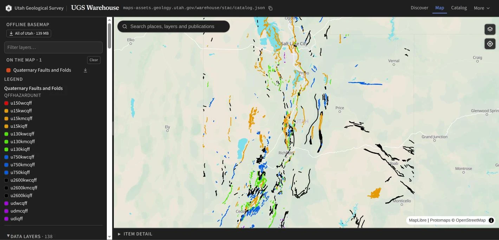
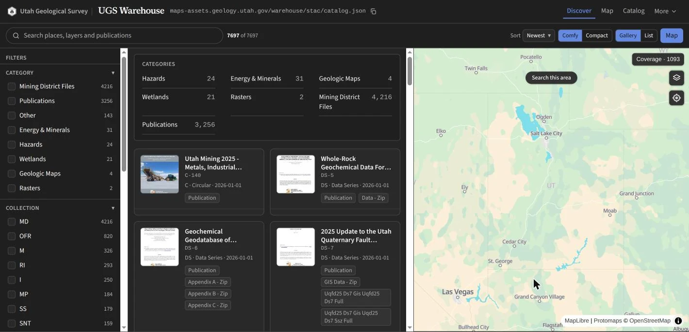
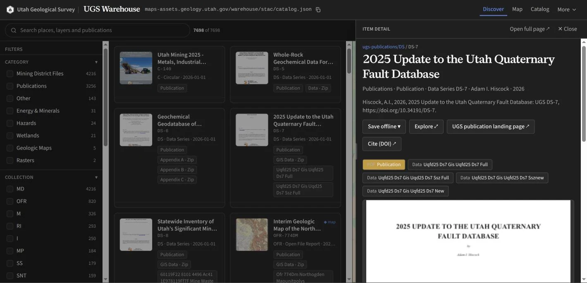

# UGS Warehouse

Cloud-native data warehouse for the Utah Geological Survey. It publishes UGS map layers, rasters
and publications as open files on a CDN, indexed by one STAC catalog.

**[Open the viewer](https://data.geology.utah.gov/)** ·
[User guide](https://data.geology.utah.gov/guide) ·
[STAC catalog](https://maps-assets.geology.utah.gov/warehouse/stac/catalog.json)



| Discover | Publication |
|---|---|
|  |  |

## What it publishes

| Source | Artifacts |
|---|---|
| Serving tables (`{schema}.{layer}_current` in Postgres) | DuckLake table, GeoParquet, PMTiles, STAC item |
| UGS publications | COG plates, map-unit polygons, cover thumbnails, STAC item |
| Standalone rasters | COG, STAC item |

All files sit in one private GCS bucket behind the `maps-assets` CDN. Clients read them directly:
the [viewer](viewer/), QGIS, STAC Browser, DuckDB, or OGC API Features through
[featureserv](featureserv/). No app server is in the read path.

## How it works

```
vector producer                         pubs producer
  Pub/Sub {schema, topic}                 publications feed (Postgres) + data zips, spreadsheets
   ↓ push → service/main.py                ↓ Cloud Run Job (sharded)
  source → transform (4326·h3·hilbert)    harvest zip→COG · map layers · covers · search
   ↓                                       ↓
  └──────────────┬─────────── core/stac.py (one item builder, one catalog) ───────────┘
                 ↓
     gs://…/warehouse/{ducklake,geoparquet,pmtiles,cogs,stac}/   →  maps-assets CDN
                 ↓                                                     ↓
         STAC catalog (collections + items.json index)          viewer/  +  STAC Browser
```

- Producers share `core/` (config, GCS, STAC). The catalog is rebuilt from what is in the bucket.
- The stack is DuckDB + DuckLake on the existing Cloud SQL Postgres, and Cloud Run. There is no
  Spark or Iceberg; UGS data fits on one node.
- Styles come from `ugs-styles` and are attached to each item. The `restyle` job rebinds them
  without a reingest.

More: [Architecture](docs/ARCHITECTURE.md) · [Serving](docs/SERVING.md) ·
[Styling](docs/STYLING.md) · [Deploy](docs/DEPLOY.md) · [User guide](docs/USER_GUIDE.md)

## Quick start

```bash
pip install -e ".[dev]"
python -m pytest tests/ -q        # hermetic, no network
ruff check src service scripts
```

Dry-run or ingest one serving table locally. This needs `gcloud` auth and `cloud_sql_proxy` to `mapping-db`:

```bash
cloud_sql_proxy -instances=ut-dnr-ugs-mappingdb-prod:us-west3:mapping-db=tcp:5433

export POSTGRES_DSN="host=127.0.0.1 port=5433 dbname=seamlessgeolmap user=$USER password=$PASS"
export DUCKLAKE_CATALOG_DSN="$POSTGRES_DSN"
export DUCKLAKE_DATA_PATH=gs://ut-dnr-ugs-maps-prod-public/warehouse/ducklake/

python -m ugs_warehouse.vector.ingest --topic hazards.hazards_qfaults_current --dry-run
python -m ugs_warehouse.vector.ingest --all     # every _current in the mart schemas
```

The pubs producer runs as `python -m ugs_warehouse.pubs.ingest`; each stage takes `--help`.
For the viewer, see [viewer/](viewer/).

## Repository layout

```
src/ugs_warehouse/
├── core/        shared by all producers: config, GCS (obstore), STAC builder, styles
├── vector/      Postgres _current → DuckLake / GeoParquet / PMTiles / STAC
├── pubs/        publications → COG / footprints / units / thumbnails / STAC
├── raster/      standalone raster COGs → STAC
└── restyle.py   rebind styles from the manifest, no reingest
service/         Cloud Run service: Pub/Sub push → vector ingest
admin/           Django + HTMX ops console (IAP) for the Cloud Run jobs
featureserv/     pygeoapi: OGC API Features over the GeoParquet
viewer/          React + MapLibre STAC viewer, on Firebase Hosting
scripts/         bootstrap catalog, manual ingest, provision Pub/Sub
docs/            MkDocs site
```

## AI use

Portions of this repository (code, infrastructure and docs) are developed with AI assistance
under human direction. AI is a supporting tool, not an author: every commit and merge is
authored, reviewed and approved by a person, who is accountable for it. This note will be
replaced with a link to UGS's survey-wide AI-use circular once it is published.
