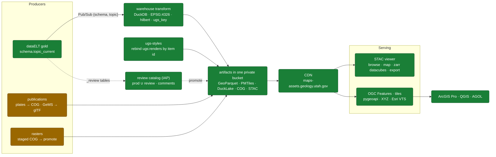

# Platform Architecture

How geologic data flows from the source databases, through the warehouse, to the maps and services
people use. The warehouse forks dataELT's published gold tables and produces cloud-native artifacts —
GeoParquet, PMTiles, DuckLake, COGs — tied together by a STAC catalog.

Legend: 🟩 built & in production · 🟧 partial / has a known gap · ⬜ not yet / blocked.



!!! tip "The detailed diagram is generated, not hand-typed"
    This page keeps the simplified spine. The full graph — every deployed Cloud Run service, the
    publications jobs, the review path — is generated from `viewer/src/shell/architecture-model.ts` and
    rendered on the viewer's **Architecture** page, where a test asserts it still covers everything
    `cloudbuild.yaml` deploys. Hand-copying that detail here is what let this page drift.

## The pipeline, layer by layer

### ① Upstream — ugs-ingest / dataELT 🟩

The warehouse does not own the data. dataELT (the ugs-ingest project) runs a dbt medallion —
bronze → silver → gold — and publishes gold as Postgres serving tables.

- Source of truth: Cloud SQL Postgres `seamlessgeolmap`, one `{schema}.{topic}_current` table per topic.
- Mart schemas scanned: `hazards`, `emp`, `gengis`, `wetlands`, `mapping`, `geochron`, `boreholes`.
- `gwportal` lives in a separate DB and is intentionally skipped.

### ② Ingest trigger — Pub/Sub #418 🟩

Every time dataELT promotes a `_current` table it publishes a `{schema, topic}` message; the
warehouse reacts. No polling, no schedule. A topic whose schema isn't a known mart is acked + skipped.
One topic ingests at a time: a run holds a lease object (`_locks/ingest/{topic}`), and a second
publish for that topic waits for it.

### ③ Warehouse transform + four sinks 🟩

One DuckDB streaming pass turns a Postgres serving table into cloud-native artifacts:

- Reproject every source CRS → **EPSG:4326**; add an H3 r9 cell; Hilbert-sort so Parquet row-groups
  bbox-prune well. (Unstamped SRID-0 geometry errors loudly rather than assuming 4326.)
- **Four sinks per topic:** DuckLake table · GeoParquet (`latest` + dated, citable) · PMTiles
  (tippecanoe, `-r1`) · STAC item (the discovery + linking layer).
- **Layer collections.** The catalog refresh also publishes each topic as its own collection,
  `ugs-serving-topics/<schema>/<id>/collection.json`, beside its item. That is Portolan's grain; the
  item stays until the viewers read the collection.
- **Durable key.** A topic whose serving table carries `ugs_key` gets DuckLake delta-MERGEs keyed on
  it (instead of a full rewrite) and a `ugs:primary_key` STAC stamp, so a row comment resolves to the
  same feature across reingests. The feature **id** stays `feature_id` — promoting `ugs_key` to the
  MVT/OGC id has to land with the viewer's id-column switch, so it's a follow-up.

### ④ Styling — ugs-styles 🟩

Cartographers work in the `ugs-styles` repo; styles bind into the catalog **by STAC item id**. At
STAC emit, a matching style attaches a `renders` block (MapLibre GL style URL). A `restyle` job
rebinds renders without a reingest.

### ⑤ Publications 🟧

Publications are a second producer into the same STAC catalog: scanned geologic maps become COGs +
footprints, routed into three groups (`ugs-publications`, `ugs-mining-district-files`,
`ugs-external`).

Each group is a Catalog of series Catalogs (`<group>/<SERIES>/catalog.json`), and each publication
is a Collection under its series (`<group>/<SERIES>/<SID>/collection.json`). The Collection holds
the documents (PDF, cover, original zips) as assets and the DOI as `cite-as` +
`sci:doi`; the plate COG, units, extracted layers and tables, and the 3D fence are its Items at
`<SID>/<ITEM_ID>/<ITEM_ID>.json`: `<SID>_plate`, `<SID>_units`, `<SID>_fence`, and `<SID>__<label>`
for each layer and table (the double underscore keeps a layer id off another publication's id,
since publication ids can hold `_`). A publication with one data file keeps it on the Collection and
has no Items. The pubs ingest writes the Collections and Items; `refresh_catalog` writes the series
and group catalogs over them.

A series switches to this layout as a whole, once every publication in it has a `collection.json`.
Until then the refresh indexes it as before, one series `collection.json` over `<SID>/<SID>.json`
items, ignores its new-layout objects, and prints the publications still pending. Publications the
feed does not list (mostly mining district files) hold their series in the old layout. After a
series switches, `pubs.prune --legacy --apply` deletes its old files, only where the replacement
exists.

Metadata comes from the publications app's live feed (`publications.pubs_feed_v1`); `PUBS_DB_URL`
is required. The ops console's **Full refresh** runs the jobs in order: cover thumbnails, 3D,
map layers from each new pub's GIS zip, a prune of items the feed no longer lists, the pubs
ingest, and the full-text search index. New map plates need **Harvest COGs** first. GeoParquet is
written with geoparquet-io, and COG band metadata is read with rio-stac. A new plate COG embeds each
band's statistics (`STATISTICS_MINIMUM/MAXIMUM/MEAN/STDDEV`, alpha included), computed over the
8-bit raster it is made from before rio-cogeo copies them in. A publisher's plain TIFF
scan is a `source` asset, and a pub with no year gets a `start_datetime`/`end_datetime` interval
flagged `ugs:date_unknown`.

Each map layer extracted from a GIS zip is written as GeoParquet in its own CRS plus PMTiles in
EPSG:4326 (`geolmap/vectors/<SID>/<label>.parquet` and `.pmtiles`), tiled with the serving topics'
tippecanoe flags and one tile layer named for the label. DuckDB reads the layer's GeoParquet,
drops rows with no geometry, reprojects from the CRS the manifest recorded (`ST_Transform`
with `always_xy`, so coordinates stay lon/lat) and streams GeoJSONSeq to tippecanoe through
`vector/sink_pmtiles.py`, so no layer is held in memory as a GeoDataFrame. The series' `_manifest.json` records
`pmtiles` and `pmtiles_layer` per layer. A layer whose tiling fails keeps its GeoParquet and gets
a `pmtiles_failed` warning instead of an error, so the pub stays extracted and is not downloaded
again; the next run's self-heal retries it (below). A tiled layer's Item carries the same `pmtiles`
asset and `rel=pmtiles` web-map link as a serving topic, so the viewer previews it and the Map page
can add it. A pub's `_units` Item (`geolmap/units/<SID>/<SID>.units.parquet`) has no PMTiles of its own; the
statewide `geolmap/units/units.pmtiles` from `pubs/units_pmtiles.py` is a separate artifact.

The manifest also records how a pub's layers and tables relate (`pubs/relations.py`). Relationship
classes a geodatabase declares are read with `ogrinfo -json`; a geodatabase whose relationships
cannot be read gets a `relationships_not_read` warning and inference still runs. Attachment
relationships (`__ATTACH`, media) are not joins and are skipped. Most GeMS databases declare none,
so joins are also inferred within one source dataset with ugs-ingest's FK scoring: a column-name
score (`scoreNameMatch`, with singular/plural folded) plus the share of the column's distinct
values (up to 5,000 sampled) found in another table's unique key, times 0.6. A join is kept when
the name score is at least 25, the overlap at least 90% and the total at least 80; or, for a source
with only a generic `*ID` name (score 10), when every sampled value, at least 3 of them, is in a key
named `*_ID` or `*ID` and the column shares a word of 4+ letters with the target table or key
(DefinitionSourceID and DataSources share "source"). Only the best join per pair of tables is kept. An inferred join targets only
a non-spatial table; a spatial layer is a target only when declared. A key needs at least 3
distinct values, an integer key numbering its rows 0..N or 1..N counts only when named for its
table, and `OBJECTID`, `OBJECTID_n`, `FID`, `FID_*`, `Id` and `Shape_*` are never keys or foreign
keys. Integer columns with nulls arrive from GDAL as float64, so they are never candidates. Each
relationship runs from the table holding the foreign key (`origin`, e.g. MapUnitPolys) to the keyed
table (`destination`, e.g. DescriptionOfMapUnits) and says whether it was `declared` or `inferred`
(with its `confidence` and `overlap`). Each layer entry records its `source` dataset, which is also
its inference scope: a geodatabase layer's label prefix (the stem, after its folder when the name
collided), or a shapefile's folder. A column that cannot be profiled gets one
`relationships_not_inferred` warning per layer, and the layer's other columns are still used.

The pubs ingest publishes them in the serving topics' shape. A non-spatial destination is a
`roles: ["data", "related"]` asset on the origin Item, keyed by the destination's label, pointing at
its existing parquet, with `ugs:foreign_keys` flipped to destination → origin so the viewer's
click-join filters the table by the clicked feature. A spatial destination is a `related` link, and
every destination links back to its origin. The origin's `data` asset carries its own foreign keys.
Each foreign key has `ugs:detected_by` and, when inferred, `ugs:confidence`. A table that at least
max(3, half the pub's map layers) of those layers point at (DataSources on a GeMS map) is a shared
lookup, and its related assets carry `roles: ["data", "related", "reference"]`. Layer and table
Items carry `ugs:layer_kind`, `ugs:source_key` (the source dataset, the grouping key) and
`ugs:source_dataset` (its title, read from the whole folder path with generic names such as
`Shapefiles` or `GIS_Data` dropped), and the Collection's `rel=item` links repeat all three so the
viewer groups a pub's items without fetching them. The kind is `layer` for a spatial layer, `table`
for a non-spatial one in a relationship the ingest publishes and `supporting` otherwise. A
relationship to a GeMS validation layer or an empty layer is skipped, since neither is published;
one naming any other label the manifest does not publish fails the pub. A relationship must say
whether it was `declared` or `inferred` (with an integer `confidence`), or the pub fails.

**Self-heal.** After extracting new pubs and retrying failed ones, every vectors run (`--all`, or
`python -m ugs_warehouse.pubs.vectors SID ...` for those SIDs) fills in what cleanly extracted pubs
are missing, from their GeoParquet on GCS and without downloading a zip:

- PMTiles for each spatial layer with none that is not `no_geometry`, including layers with a
  `pmtiles_failed` warning (the warning clears once the layer tiles). The GeoParquet is downloaded
  to the job's disk and tiled the same way as at extraction;
- relationships for each manifest with no `relations_version`, or one older than
  `relations.RELATIONS_VERSION`. Only the string and integer columns are range-read from GCS,
  never the geometry. Bumping that number with a change to the inference rules makes the
  next runs recompute every pub's relationships. Declared relationships already recorded are kept,
  since the geodatabase is not at hand, and nothing is written for a pub with a layer that cannot
  be read. Scopes come from the labels, as at extraction. When a label carries a folder prefix
  because its name was taken, the bundle has several folders and a bare shapefile label's folder is
  unknown: it is left out of inference with a `relationships_scope_unknown` warning until `--force`
  re-extracts;
- each per-pub units file (`geolmap/units/<SID>/<SID>.units.parquet`) whose Parquet footer, read by
  range, says GeoParquet older than 1.1 or no bbox covering is rewritten through
  `pubs.geoparquet.write` to the same path, with a mutable cache header.

A run keeps only `{series id: what it lacks}` (the layers without tiles, and whether relationships
are missing) for the whole catalog, and reads a series' manifest again, with `put_bytes_if_unchanged`,
only when it heals it. Series whose only work is retrying a failed layer go last. In a regular `--all` run, extraction and
the self-heal share one time budget, `VECTORS_TIME_BUDGET_S` (default 2700 s, inside the job's
7200 s timeout). Extraction goes first: it stops starting pubs once the budget is spent and lists
the pubs left for the next run, so the self-heal only runs once the backlog of new pubs is cleared.
The self-heal stops starting series, finishes the one in progress, and prints `Self-heal: N layers
tiled, M pubs' relationships recorded, units upgraded: U; K layers, J pubs and P units files still
pending, the next run continues`. Targeted and forced runs extract every pub they are given; a
forced run re-extracts everything, so nothing is left to heal.

The run exits 1 only for work that failed in that run: a pub that failed to extract, a layer whose
tiling failed at extraction, or a layer or pub whose self-heal failed (each is listed). Work the
time budget left pending is not a failure.

The pubs ingest (4Gi) heals relationships and units files before it writes the items (stopping new
series after 600 s), so any refresh catches those up and publishes them in the same run. It does
not tile: tiling reads whole layers and belongs to the vectors job. **Rebuild pubs STAC** alone
therefore does not build missing PMTiles; a **Full refresh** does, because it runs the vectors job
before the ingest. The ingest reads each vector manifest once, on 16 threads, keeps the reduced
form the items are built from plus the small needs index, and reads again only the series the heal
changed. Pubs extracted before PMTiles and relationships were recorded catch up this way: repeat a
refresh until it reports 0 pending. After the units files have caught up, purge the CDN
cache for `geolmap/units/` once: the old files were served as immutable, so the edge keeps them until
purged.

Publication **files** (PDFs, plate/GIS zips, tables) are hosted on `ugspub.nr.utah.gov`, not by us.
`pubs/mirror.py` copies a selected slice into the bucket under `pubs/files/` — path-preserving, so
the legacy URL's path *is* the object path. A mirrored file's asset serves from our CDN and keeps
the publisher's URL as an `alternate`; unmirrored files stay linked to the publisher.

```bash
python -m ugs_warehouse.pubs.mirror --dry-run   # default slice: pubs with a harvested COG
python -m ugs_warehouse.pubs.mirror             # then re-run pubs.ingest to repoint the assets
```

!!! note "Honest gaps"
    **Metadata source.** `PUBS_DB_URL` is required: live MySQL, or live Postgres through the
    DuckDB postgres extension. Prod reads the publications feed on Cloud SQL. There is no file
    fallback, so a run without the database stops instead of publishing a stale snapshot.

    **File hosting.** The mirror is selective by design (#120): map pubs only, ~81 GB of a ~200 GB
    full mirror. Everything else still depends on the legacy host, which sends no CORS header — so
    browser code can navigate to those files but never read their bytes.

### ⑥ Storage, serving & consumers 🟩

Artifacts land in one private GCS bucket and are served read-only through the **maps-assets CDN**,
which preserves object paths.

- Static surfaces (no server): GeoParquet, PMTiles, COG, Zarr, STAC JSON — read directly from the CDN.
- STAC viewer: catalog browse + map + COG preview + zarr datacube layers + client-side export.
- OGC API Features for ArcGIS Pro / QGIS: pygeoapi over the GeoParquet, scale-to-zero.
- `ugs-warehouse-tiles`: XYZ tiles, ready-made MapLibre styles, and an Esri VectorTileServer facade
  so AGOL and Pro can add a layer at all.
- Background jobs: topic thumbnails, the `restyle` rebind, and weekly DuckLake maintenance.
- External catalogs (USWB) federate in as children of the root, so one catalog URL covers them.

### ⑦ Review path 🟩

The same pipeline against `_review` serving tables, written under `review/` prefixes and served
behind IAP. The review app federates prod ∪ review and takes comments at item, column and row level;
promotion turns a thread into read-only history rather than deleting it.

## What's still open

The vector pipeline is end-to-end in production. The honest gaps:

- 🟧 **Raster path** — consume/promote is deployed and provisioned (#61 closed 2026-07-26), and the
  COG→STAC sink lands items in `ugs-rasters`. What's left is quality, not wiring: promoted items
  don't render on the viewer map because the visual asset is the native-CRS COG (#84), `native_crs`
  is trusted text that's never verified against the promoted COG (#83), and promote shares an
  instance with ingest with no dead-letter policy, so one bad message is an outage (#81).
- 🟧 **STAC `datetime`** is ingest time, not data-validity time — waiting on an upstream validity timestamp.
- 🟧 **Publication files** — only the map-pub slice is mirrored; the rest live on the legacy host (#120).
- 🟧 **Legacy pubs** — 1,163 catalog items, mostly legacy mining district scans, have no record in
  the publications app. The prune keeps them until they are imported or retired (#491).
